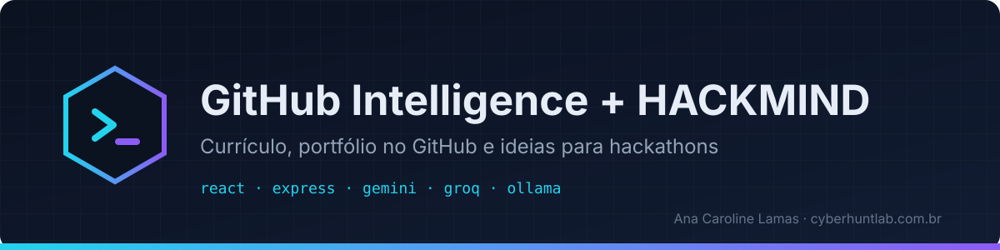

<p align="center"></p>

# GitHub Intelligence Career Suite + HACKMIND — currículo, portfólio e hackathons com IA

Plataforma full-stack (**React + Vite** e **Express**) para alinhar **currículo, portfólio no GitHub e desenvolvimento de projetos**. Esta versão une a **GitHub Intelligence**, que faz curadoria, auditoria e README de perfil, ao **HACKMIND**, um motor que pesquisa competições, gera e avalia hipóteses e monta planos de MVP para hackathons.

## Fluxo principal

1. **Currículo e perfil profissional**: envie o currículo, revise o perfil extraído e defina o cargo-alvo.
2. **Curadoria dos repositórios**: conecte o GitHub e avalie relevância, riscos, privacidade, README e metadados de cada repositório.
3. **Modernização**: revise as alterações propostas antes de aplicar; nada é apagado automaticamente.
4. **Hackathons e ideias**: pesquisa, hipóteses, comitê adversarial, pontuação, originalidade, plano de MVP e exportação em Markdown.
5. **Revisão final**: valide portfólio e documentos antes de publicar.

## Recursos

- **Classificação de relevância** por repositório: alta, complementar, baixa ou "precisa de revisão".
- **Auditoria de segurança** com busca de segredos expostos e checagem de README, workflows e arquivos de backup.
- **Ações no GitHub com confirmação**: visibilidade, arquivamento, PR do README de perfil e exportação de pastas.
- **Currículo ATS**, projetos de carreira, ideias de startup e prompts de implementação.
- **Documentos em PDF** (jsPDF) com histórico.
- **HACKMIND** (`hackmind-engine/` + `src/hackathons/`): provedores Groq, NVIDIA NIM, Ollama, endpoint compatível com OpenAI ou motor determinístico; testes de pontuação.

## Instalação

Requisitos: **Node.js 20+** (recomendado 22+) e npm.

```bash
git clone https://github.com/ticarollamas-arch/github-intelligence-career-ai.git
cd github-intelligence-career-ai
npm install
cp .env.example .env
```

| Variável | Uso |
|---|---|
| `GEMINI_API_KEY` | Google Gemini (curadoria, currículo, ideias) |
| `AI_DEFAULT_PROVIDER` / `AI_DEFAULT_MODEL` | Provedor e modelo padrão do HACKMIND |
| `GROQ_API_KEY`, `NVIDIA_NIM_API_KEY` | Provedores em nuvem |
| `OLLAMA_BASE_URL` / `OLLAMA_MODEL` | Ollama local (ex.: `qwen2.5`) |
| `CUSTOM_AI_BASE_URL`, `CUSTOM_AI_API_KEY`, `CUSTOM_AI_MODEL` | Endpoint compatível com OpenAI |
| `APP_URL` | URL pública (opcional) |

Mantenha as chaves só no backend; não use o prefixo `VITE_` em segredos.

## Como usar

```bash
npm run dev            # http://localhost:3000
npm test               # testes de pontuação do HACKMIND
npm run build && npm start
```

> Nenhuma rotina exclui projetos, altera visibilidade ou publica commits sem confirmação explícita. Faça backup antes de aplicar mudanças em lote.

## Limitações

- A integração visual e funcional do HACKMIND ainda precisa de validação em build e navegador.
- Recursos comerciais (cobrança, licenças, cupons, painel administrativo) não estão implementados. Veja [IMPLEMENTACAO_PENDENTE.md](IMPLEMENTACAO_PENDENTE.md).
- No Android, o seletor de arquivos pode entregar URIs de provedores como o Google Drive em vez de pastas locais. Selecione os arquivos ou baixe a pasta antes de enviar.

## Tecnologias

TypeScript · React 19 · Vite · Tailwind CSS · Express · Google Gemini · Groq · NVIDIA NIM · Ollama · GitHub REST API · jsPDF · tsx (testes)

## Licença

Distribuído sob a licença MIT. Veja [LICENSE](LICENSE). Dependências de terceiros mantêm suas próprias licenças.
